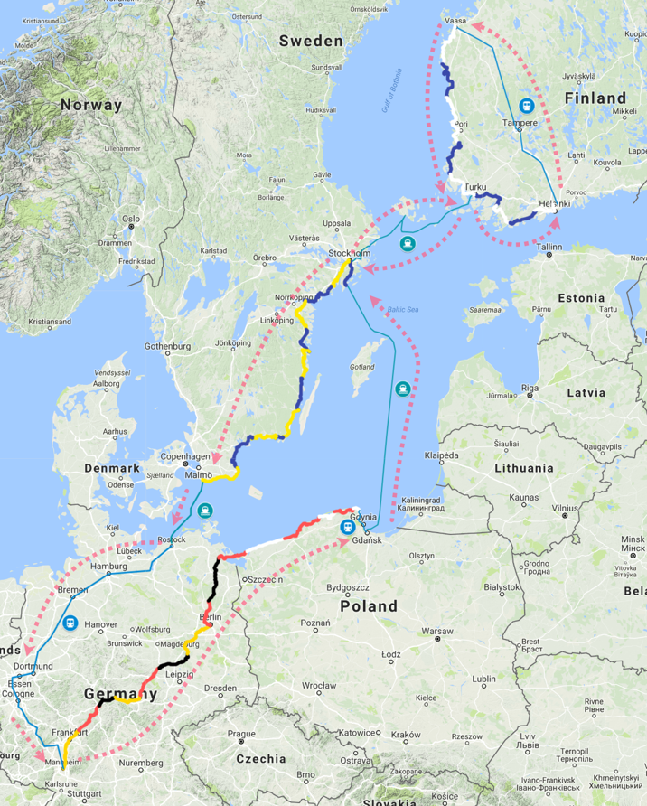

# Route

# Motivation for this tour

Boundary conditions:
- my grandma lives in Finland
- my girlfriend's a teacher who had the month of August off from school
- I love cycling
- I had saved up some extra time at work

So when planning my sabbatical, I had the idea that I could combine all of my interests and cycle from Mannheim (Germany) to Vaasa (Finland) to see my grandma, and then cycle back through Finland and Sweden with my girlfriend during her summer break.

# Equipment on this tour

So, cycling to Finland was my first big cycling trip. I wasn't sure how I would fare. Maybe I would even hate it and abort the whole thing. So I didn't want to spend exorbitant amounts on my gear. I did lots of research to find gear that was somewhat small and lightweight — but not the top-of-the-range stuff.

So here are some key components:

- **Bicycle:** [Pegasus Sololero SL Disc](https://www.radonline.de/pegasus-solero-sl-disc-24-gang-kettenschaltung-herrenfahrrad-trekking-modell-2018-28-zoll-rot-grau-schwarz.html)
- **Tent:** [CAMPZ Lacanau Zelt 2P](https://www.campz.de/campz-lacanau-zelt-2p-grey-green-887322.html)
    I was also really satisfied with this tent. The price-to-weight/size ratio is really good. The only downside is that you have to pitch the inner tent before you can pitch the outer tent — which could be a downside when putting it up in heavy rain.
- **Air mattress:** Decathlon [Trek 700 XL gelb XL](https://www.decathlon.de/p/trekking-luftmatratze-trek700-air-xl-gelb/_/R-p-189394)
    I was so satisfied with sleeping on this. Highly recommended!
- **Sleeping bag:** Decathlon Trek 500 10 °C XL
- **Robens Pump Sack** to inflate my mattress — worked really well.
- **Rear panniers:** 2 x Ortlieb Back Roller — the default pannier bags for spotting German cycle tourists. ;) I have been happy with these for years.
- **Front panniers:** 2 x Vaude Aqua Front — I like the Ortlieb QL lock system better than the Vaude system.
- **Lowrider:** [Zefal Raider](https://www.bike-discount.de/de/kaufen/zefal-raider-front-lowrider-37389?delivery_country=48&gclid=Cj0KCQjw7sDlBRC9ARIsAD-pDFqBSFbJ6pt-9aLbsw7M9ZdpMLcRfLtNCiTcF_Mmiir2NTy1CJMAoHQaAu-QEALw_wcB)
- **Handlebar bag:** [Red Cycling Products Front Loader III schwarz](https://www.amazon.de/Red-Cycling-Products-Lenkertasche-Loader/dp/B07BH2FDPV)
- **Hammock:** [with mosquito net](https://www.aliexpress.com/item/Ultralight-Outdoor-Camping-Hunting-Mosquito-Net-Parachute-Hammock-2-Person-Flyknit-Hamaca-Garden-Hamak-Hanging-Bed/32823813650.html)
- **Bar ends:** [ergotec Bar Ends Touring](https://www.amazon.de/dp/B006W4JFCW/)
- **Phone mount:** [Similar to this](https://www.aliexpress.com/item/Bike-Phone-Holder-Mount-Bracket-Stand-Practical-Aluminium-Alloy-Phone-Mountain-Bike-Mobile-Phone-Holder-Bicycle/32915573992.html) I have tried out many phone mounts for my bike — but this one has lasted forever and never dropped my phone. Highly recommended.
- **Cycle2Charge:** a USB charger connected to my hub dynamo. This didn't really work well for me. The max. output was only 800 mAh, and when you got too slow, the phone detected a voltage change and stopped charging. Then you would need to disconnect the cable and connect it again. But this would be quite bad, to start so many charging cycles. I ended up charging using my solar panels or when I had lunch.

# Learnings

* You can never pack enough zip ties! These things are invaluable!
* Deflate your tires when you are on very sandy stretches.
* Don't blindly trust the EuroVelo route.

# Routing

There is the [EuroVelo 10](http://www.eurovelo.com/en/eurovelos/eurovelo-10) cycle route going all around the Baltic Sea. So I figured I just needed to make it through Germany to the north-east — and then I'd just follow the signs and be golden. It turned out that it wasn't so easy, and in Poland the cycle routes weren't that great. But more about that later.

I used an old Android phone (Sony Xperia M2) for navigation and tracking my route. This worked out alright. In the beginning I used [Komoot](https://komoot.de) to navigate through Germany, but for long-distance routing and re-planning when you've strayed away from the route, I didn't like it so much. Later I switched to [OruxMaps](https://www.oruxmaps.com/cs/en/) and downloaded OSM map files with the [EuroVelo 10 route](https://www.openandromaps.org/en/eurovelo-cycle-maps/ev10-baltic-sea-cycle-route) embedded.

# Documenting the trip

Originally, I had documented and "blogged" the trip on Instagram. This turned out to be less than ideal, because I learned later that some of my friends didn't realize that I had posted more than just the daily route summary, and they would have needed to swipe through the other pics.

As I am planning to do another trip this summer, I am now documenting this one on my blog as well, including the pics and info from my Instagram account.

# Staying clean(ish)

## Laundry

Keeping clothes clean on the road requires a bit of planning ahead. As I like to stay out in the wild and on the road as much as possible, this is what I did for laundry: I have a dry bag made of rigid PVC material. So for laundry I just need a tap for water and then some sink or toilet to dispose of the dirty water. I brought powdered laundry detergent with me. So I let my clothes soak with the detergent, then worked them with my hands, and then did 2 or 3 rinse cycles. Then I hung my clothes all around my bicycle.

## Personal hygiene

* Public swimming pools / beaches
* Gyms
* Golf clubs (they even let us use the sauna for free several times)
* Water taps / wells in the wild

Whenever I found a place to shower, I typically also did some quick laundry as described above.

# Finding places to sleep

## Germany

In Germany, "wild camping" is officially not allowed. Most land in Germany is owned by somebody — so you'd need to ask the landowner for permission to camp. In state-owned forests the law states that it is forbidden to sleep in tents ("Zelten verboten"), so there seems to be some legally gray area when you rest/sleep without a "tent". A hammock, bivouac or tarp should be fine.

This is why in Germany I resorted to looking for shelters on OpenStreetMap and slept in a hammock there. As long as you behave, don't make a fire and pick up after yourself, you should be fine.

## Poland

Wild camping seems to be forbidden here as well. I didn't want to risk it and slept on camping sites. However, in the summer months it seems like ALL the Poles head to the seaside, so the beach seems like a walrus colony in the beach towns. The camp sites are also rather big and crowded. What seems to be better is to look for "agroturystyka" camp sites.

## Sweden

Camping in the wild is allowed in all the Nordic countries ("[allemansrätten](https://en.wikipedia.org/wiki/Freedom_to_roam)"). However, if you are really out in the woods, it's not so easy to find an even place where you can pitch your tent. But there is a great Facebook group who are putting all the public shelters (vindskydd) which are free to use on a Google map: [Vindskydd i Sverige](https://maps.gonehiking.se/), often including some images and additional info. So many places had a loo, firewood and a fireplace. However, due to the extremely hot summer, we were only allowed to light a fire on our last night in a shelter. All the days before, it was strictly prohibited to light a fire.

We found it great to put up the inner tent net inside the shelters to protect ourselves from the mosquitoes.

## Finland

Same goes for Finland. They also have shelters (fi: _laavu_ / se: _vindskydd_). On this page you can download the GPS coordinates for shelters per municipality: [All shelters in Finland GPX](http://www.laavu.org/lataa.php?paikkakunta=kaikki). I also put these on a [custom Google map](https://drive.google.com/open?id=1br0w7K6ubw3060d-aUWBsILBNxsFnrIh).

## Denmark

Even though I hadn't toured through Denmark yet, I also found a nice list of shelters here: [naturstyrelsen.dk](https://naturstyrelsen.dk/naturoplevelser/overnatning/shelters/)

# All blog entries from this trip
