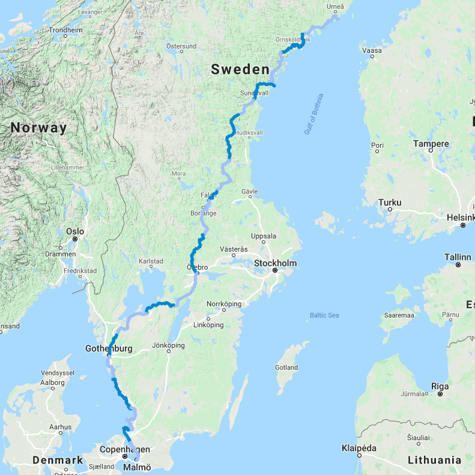

## Route

## Why this route

A few things came together:
- my grandma lives in Finland
- my girlfriend's a teacher who had the month of August off from school
- I love cycling
- I had saved up some extra time at work
- we liked the possibility of camping in the wild, like we did in Sweden last year

## Day by day
